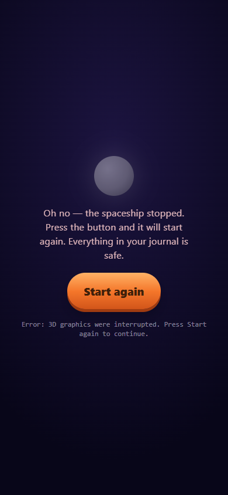
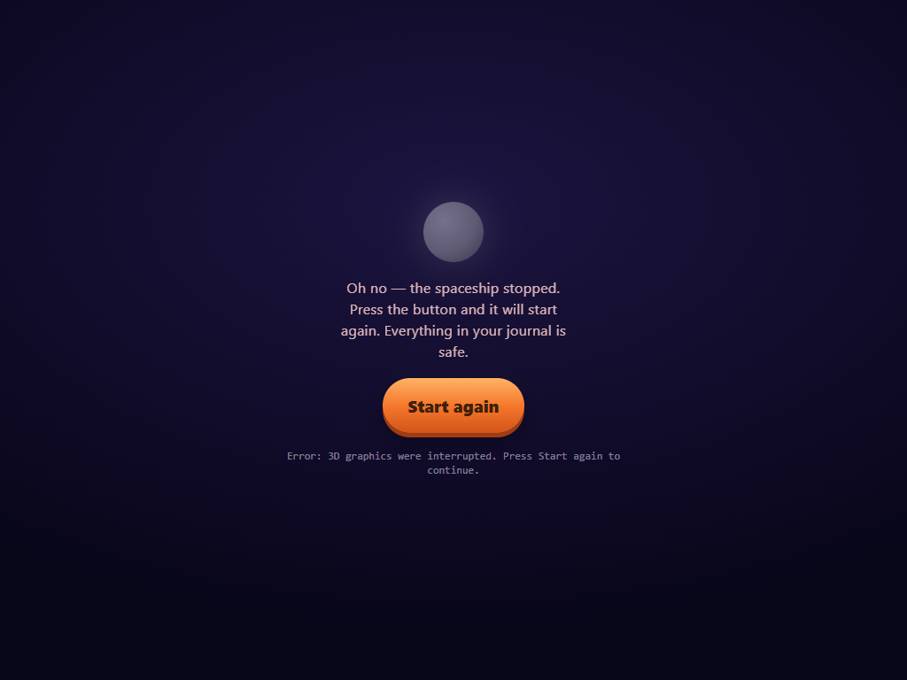

# Graphics-loss recovery review — 17 October 2026

Baseline: GitHub main `6a8b891`. Captured before renderer changes in this isolated
checkout, with its own `npm ci`; no linked dependencies. Every image uses
`deviceScaleFactor: 1` and the same native `WEBGL_lose_context` reproduction during
an Earth flight. The baseline was reproduced twice on phone and once on the other
viewports. These are software-WebGL captures, not physical tablet observations.

The existing crash screen is now shown for context loss. Its artwork, layout and
wording are unchanged; its diagnostic identifies the graphics interruption.
Start again reloads the page, retaining saved progress and device preferences.
The owner authorized merging on 17 October after these captures were delivered.
The earlier unexplained black-screen report has not been established to share this
cause. Integration with main `1a0a2b1` removes the retired experiment-route checks
and verifies graphics loss during the new day/night house activity instead.

## Phone — 390 × 844

| Before: loss leaves no recovery control | After: existing restart screen |
| --- | --- |
|  |  |

## Tablet — 1024 × 768

| Before | After |
| --- | --- |
|  |  |

## Short landscape — 844 × 390

| Before | After |
| --- | --- |
|  |  |
